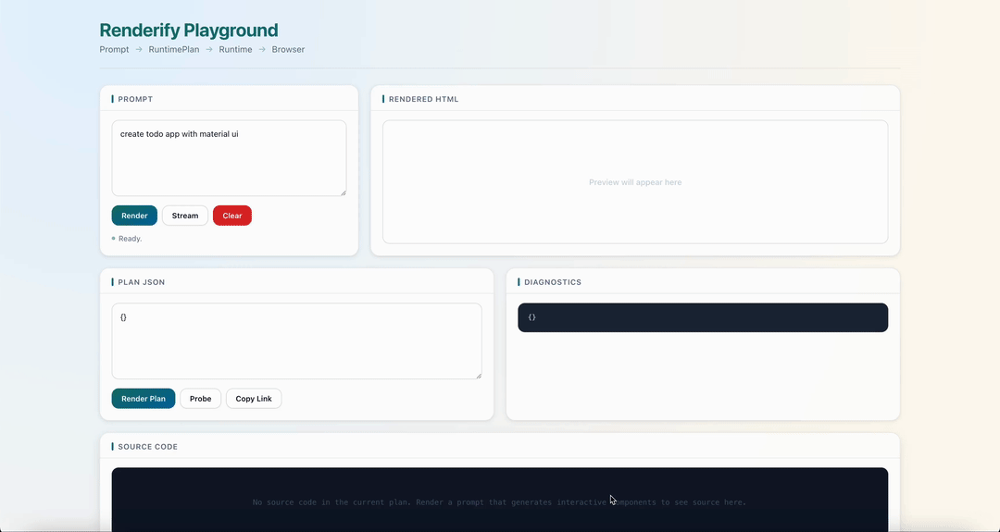
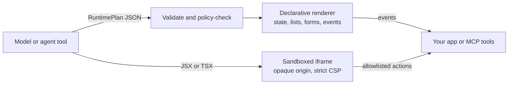
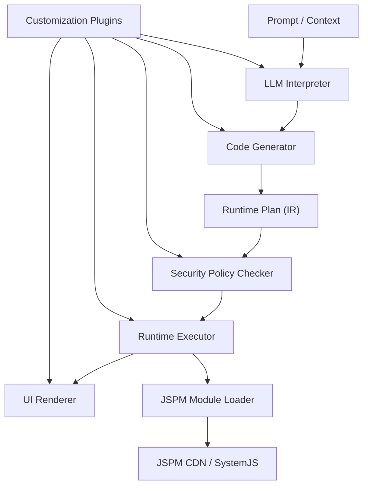
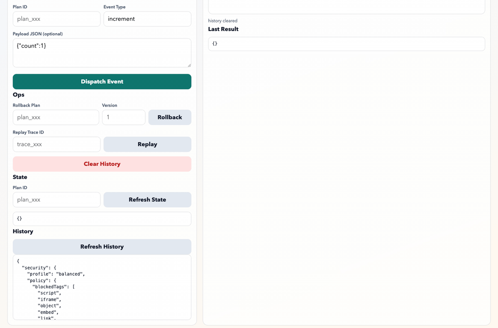

<p align="center">
  
</p>

<h1 align="center">Renderify</h1>

<p align="center">
  <strong>Renderify renders the UI your model describes.</strong><br>
  Validated RuntimePlans (JSON with state, lists, forms, and events) render by default;
  model-written JSX runs in a sandboxed iframe when a plan is not enough.
  No build server, no deploy step.
</p>

<p align="center">
  <a href="https://github.com/webllm/renderify/actions/workflows/ci.yml"></a>
  <a href="https://www.npmjs.com/package/renderify"></a>
  <a href="https://www.npmjs.com/package/renderify"></a>
  <a href="./LICENSE"></a>
</p>

<p align="center">
  <a href="https://webllm.github.io/renderify/docs/"><strong>Documentation</strong></a> ·
  <a href="https://webllm.github.io/renderify/playground/"><strong>Playground</strong></a> ·
  <a href="docs/getting-started.md"><strong>Getting Started</strong></a> ·
  <a href="docs/integrations.md"><strong>Integrations</strong></a> ·
  <a href="#examples-and-templates"><strong>Examples</strong></a>
</p>

<p align="center">
  
</p>

Renderify is the rendering layer for generative UI. Return a RuntimePlan from a
Vercel AI SDK, AG-UI, or MCP tool and render it with `<RenderifyView>` in React,
with the browser runtime in any page, or inside an MCP Apps host. Plans are
validated and policy-checked before they render, and only the actions you allow
reach your app.

<details>
<summary><strong>Table of contents</strong></summary>

- [30-Second Example](#30-second-example)
- [Where Renderify Fits](#where-renderify-fits)
- [What Renderify Does](#what-renderify-does)
  - [Highlights](#highlights)
- [Who This Is For](#who-this-is-for)
- [Runtime Pipeline](#runtime-pipeline)
- [Implemented Capabilities](#implemented-capabilities)
- [SDK Quick Start (Non-CLI)](#sdk-quick-start-non-cli)
- [CLI Quick Start](#cli-quick-start)
  - [Playground Hash Deep-Link](#playground-hash-deep-link)
- [Killer Demo](#killer-demo)
- [Programmatic Example](#programmatic-example)
- [Renderer-only Usage (No Built-in LLM)](#renderer-only-usage-no-built-in-llm)
  - [Renderer-only TSX + Dependency Package (JSPM)](#renderer-only-tsx--dependency-package-jspm)
  - [Bundleless Contract](#bundleless-contract)
- [MCP Apps (Offline Declarative)](#mcp-apps-offline-declarative)
- [Package Topology](#package-topology)
- [Documentation](#documentation)
- [Examples and Templates](#examples-and-templates)
- [Technical Highlights](#technical-highlights)
- [Contributing](#contributing)
- [License](#license)

</details>

## 30-Second Example

```bash
npm install @renderify/react @renderify/ir
```

```tsx
import { RenderifyFrame, RenderifyView } from "@renderify/react";

// A RuntimePlan from your model, for example a tool result.
<RenderifyView plan={plan} onEvent={(event, state) => console.log(event, state)} />;

// Model-written JSX, rendered in an opaque-origin sandboxed iframe.
<RenderifyFrame source={code} allowedActions={["save"]} onAction={save} />;
```

Want to try plans or JSX without installing anything? Use the
[static Playground](https://webllm.github.io/renderify/playground/). It runs the
renderer in your browser and never makes an LLM request. The
[Getting Started guide](docs/getting-started.md) covers plain JavaScript, agent
frameworks, and MCP servers.

## Where Renderify Fits

Agent frameworks and protocols decide how UI travels between a model, your
backend, and your app. Renderify is the renderer at the end of that path, so it
works alongside them:

| | What it standardizes | How Renderify fits |
| --- | --- | --- |
| **Vercel AI SDK, CopilotKit, assistant-ui** | Tool calling and chat state in your app | A `render_ui` tool returns a RuntimePlan and `<RenderifyView>` renders it. See [integrations](docs/integrations.md). |
| **AG-UI** | Events between agent backends and frontends | Plans travel in tool results and render in any AG-UI frontend. |
| **MCP Apps** | How MCP servers ship UI into host applications | `@renderify/mcp-app` serves the view and renders validated, offline plans inside it. |
| **A2UI** | Declarative UI composed from the client's trusted component catalog | Complementary: A2UI composes your catalog's native components across platforms; Renderify describes web UI at the element level with its own state, or runs model-written JSX in a sandbox. |
| **App builders and in-browser IDEs** (v0, Bolt.new, Sandpack, WebContainers) | Building and running whole projects | Renderify renders one UI inside your existing app at runtime, without a project build. |

In each case Renderify adds one validated IR with a security policy checked
before anything renders, local interactivity without another model call, and a
sandboxed lane for open-ended code.

## What Renderify Does

Renderify has two lanes. Plans are the default; the sandboxed lane is there for
UIs a plan cannot express.



|                   | Validated plans (default)                                                    | Sandboxed JSX                                                        |
| ----------------- | ---------------------------------------------------------------------------- | -------------------------------------------------------------------- |
| **Input**         | RuntimePlan JSON                                                             | JSX or TSX source                                                    |
| **What runs**     | No model code: the plan is validated, then rendered                          | Model code, inside an opaque-origin `sandbox="allow-scripts"` iframe |
| **Interactivity** | State, lists, conditions, forms, and bound inputs, without another model call | Anything Preact- or React-compatible, with npm packages from JSPM    |
| **React**         | `<RenderifyView plan={plan} />`                                              | `<RenderifyFrame source={code} />`                                   |
| **Without React** | `renderPlanInBrowser(plan, { target })`                                      | `createRenderifyFrame({ container })`                                |
| **Good for**      | Forms, dashboards, cards, MCP Apps                                           | Charts with npm libraries, custom components                         |

### Highlights

**Render**

- **Interactive declarative plans**: lists (`each`), conditions (`if`), two-way `bind` for form fields, form submit, and state transitions, with no code execution. See the [RuntimePlan IR reference](docs/runtime-plan-ir.md).
- **Zero-build rendering**: LLM-generated JSX/TSX runs directly in the browser via `@babel/standalone` + JSPM CDN. No backend build server, no deploy step, no server round-trip.
- **JSPM package support (tiered contract)**: Compatibility aliases (`preact`/`react` bridge, `recharts`) are guaranteed; pure browser ESM packages (for example `lodash-es`, `date-fns`, `@mui/material`) are best-effort. Node.js builtins and unsupported schemes are rejected deterministically. This is the concrete scope of the [bundleless contract](#bundleless-contract).
- **Default auto-pin-latest for bare imports**: `renderPlanInBrowser` automatically resolves bare source imports (for example `import { format } from "date-fns"`) through JSPM latest and injects pinned `moduleManifest` entries before policy check and execution.

**Secure**

- **Sandboxed source lane**: `@renderify/frame` runs model-written JSX/TSX in an opaque-origin iframe with a strict CSP, an action allowlist, loop guards, and a watchdog. See [ADR-0002](docs/adr/0002-sandboxed-source-frame.md).
- **Security-first execution**: Every plan passes through a policy checker (blocked tags, module allowlists, tree depth limits, execution budgets) _before_ any code runs. Four built-in profiles: `strict`, `balanced`, `trusted`, `relaxed`; strict and balanced reject runtime source modules.
- **JSPM-only strict preset**: Set `RENDERIFY_RUNTIME_JSPM_ONLY_STRICT_MODE=true` to force strict profile + manifest/integrity enforcement + preflight fail-fast + no fallback CDNs.

**Integrate**

- **React bindings**: `@renderify/react` provides `<RenderifyView>`, `<RenderifyFrame>`, and `useRenderifySession`, with a [Next.js chat template](templates/nextjs-chat) and an [MCP server template](templates/mcp-server).
- **Official MCP Apps adapter**: `@renderify/mcp-app` serves a self-contained `ui://` resource for offline declarative RuntimePlans, with official protocol lifecycle handling and a strict no-source/no-network boundary by default; an opt-in source mode renders model-written JSX in a nested sandboxed frame.
- **Pluggable at every stage**: 10 hook points (`beforeLLM`, `afterCodeGen`, `beforeRender`, etc.) let you inject custom logic without forking the core.

**Generate**

- **One contract for every model**: the same JSON Schema, validation, and repair diagnostics for OpenAI, Anthropic, Google, Ollama, LM Studio, and Codex, measured by nightly [generation evals](docs/generation-evals.md).
- **Dual input paths**: Accepts both structured JSON RuntimePlans (for precise LLM structured output) and raw TSX/JSX code blocks (for natural LLM text generation).
- **LLM is optional**: You can use Renderify as a renderer-only runtime by supplying RuntimePlan/source from your own backend or model pipeline.
- **Streaming-first rendering**: `renderPromptStream` emits `llm-delta` / `preview` / `final` chunks so chat UIs can progressively render.

## Who This Is For

- **LLM chat / agent platforms** that need to render dynamic UI from model output (dashboards, forms, cards, data visualizations)
- **AI Agent toolchains** — an Agent analyzes user data and dynamically generates an interactive dashboard or operation interface, rather than just returning text
- **Low-code / No-code AI backends** — users describe intent in natural language, the LLM generates a runnable UI component on the fly
- **Dynamic forms & approval flows** — generate context-aware forms at runtime, more flexible than JSON Schema renderers
- **Rapid prototyping** workflows where you want to go from prompt → rendered UI in seconds, not minutes
- **Any application** that needs to render validated declarative UI or reviewed dynamic source in the browser

## Runtime Pipeline



## Implemented Capabilities

<details>
<summary>Runtime protocol, sandbox profiles, source pipeline, dependency preflight, and tooling</summary>

- Runtime plan model with optional `state` (when provided, `state.initial` is required)
- Runtime quotas and limits:
  - `maxImports`
  - `maxExecutionMs`
  - `maxComponentInvocations`
- Runtime protocol contract:
  - `specVersion` (default `runtime-plan/v1`)
  - `moduleManifest` for deterministic module resolution
- JSX runtime modes:
  - `source.runtime: "renderify"` for RuntimeNode-oriented execution
  - `source.runtime: "preact"` for hooks + React-compatible component rendering (trusted/relaxed policy mode)
- Runtime sandbox profile:
  - `executionProfile: "isolated-vm"` is reserved for a future secure component isolation backend
  - current runtimes fail closed before loading modules when that profile is requested
  - trusted callers can explicitly set `allowIsolationFallback: true` to run it as `standard` without isolation
  - browser source sandbox with `sandbox-worker` / `sandbox-iframe` / `sandbox-shadowrealm` execution profiles; all three use a terminable Worker boundary (`iframe` and `shadowrealm` remain compatibility names)
  - runtime-level controls: mode / timeout / fail-closed
- LLM structured contract:
  - prompt flow prefers structured `runtime-plan` output
  - auto fallback to text generation when structured payload is invalid
- TSX/JSX runtime source pipeline:
  - `codegen` extracts fenced `tsx/jsx/ts/js` blocks into `plan.source`
  - runtime transpiles source via Babel (browser `@babel/standalone`)
  - import specifiers are resolved via `es-module-lexer` + JSPM loader strategy (less regex fragility)
  - browser runtime rewrites source module graphs so transitive bare imports resolve at runtime
- Dependency preflight before execution:
  - probes `imports`, `component modules`, and `source imports`
  - optional fail-fast mode for CI/production gates
  - retry + timeout + multi-CDN fallback for remote module fetches
- Browser asset module proxying:
  - CSS imports are converted to runtime style-injection proxy modules
  - JSON imports are converted to ESM default exports
- React ecosystem compatibility bridge:
  - `react`, `react-dom`, `react-dom/client`, `react/jsx-runtime` are mapped to `preact/compat` equivalents
  - enables direct runtime rendering for React-first packages (e.g. `recharts`, `@mui/material`)
- LLM provider package (`@renderify/llm`) with built-in OpenAI, OpenAI Codex, Anthropic, Google, Ollama, and LM Studio providers
- Runtime source static policy checks (blocked patterns, dynamic import policy, source import count)
- Streaming prompt pipeline (`renderPromptStream`) with progressive preview updates
- Preact DOM reconciliation path for runtime source modules (diff-based UI updates)
- Security profiles: `strict | balanced | trusted | relaxed`
- RuntimePlan structural guards for safer plan ingestion
- One-line embed API: `renderPlanInBrowser(plan, { target })`
- Interactive session API: `createInteractiveSession(plan, { target })` with event->state->rerender loop
- Browser runtime playground (`renderify playground`) for live prompt/plan/stream/probe flows
- Unit tests for `ir/core/runtime`
- CI matrix (`Node 22 + Node 24`) for typecheck/unit + quality gates
- PR changeset enforcement for release-relevant package changes
- Benchmark workflow with JSON artifacts uploaded per CI run

</details>

## SDK Quick Start (Non-CLI)

Use Renderify directly in your app code (no `pnpm cli`).

```bash
pnpm add renderify
```

```ts
import { renderTrustedPlanInBrowser } from "renderify";

await renderTrustedPlanInBrowser(
  {
    specVersion: "runtime-plan/v1",
    id: "quickstart_non_cli",
    version: 1,
    root: { type: "text", value: "Loading..." },
    source: {
      language: "tsx",
      runtime: "preact",
      code: `export default () => <section>Hello from Renderify SDK</section>;`,
    },
  },
  { target: "#mount" },
);
```

For pure browser pages without a build tool, load `@babel/standalone` before running TSX/JSX source.

## CLI Quick Start

```bash
# Render prompt and print HTML
pnpm cli -- run "Build a welcome card"

# Print RuntimePlan JSON
pnpm cli -- plan "Build a welcome card"

# Probe RuntimePlan compatibility (policy + runtime preflight diagnostics)
pnpm cli -- probe-plan examples/runtime/recharts-dashboard-plan.json
# side-effect free: does not execute plan source/component logic

# Execute RuntimePlan file
pnpm cli -- render-plan examples/runtime/counter-plan.json

# Local development Playground (includes optional LLM actions)
pnpm playground
```

The playground listens only on `127.0.0.1` by default. Remote access requires
an explicit `--host <host>` option or `RENDERIFY_PLAYGROUND_HOST` override; use
a non-loopback binding only on a trusted network.

The playground always processes plans through the server's configured
security/runtime boundary first. Eligible reviewed `source.runtime: "preact"`
plans are then transpiled and mounted in the browser so hooks, React-compatible
packages, CSS-in-JS, and event handlers remain interactive. Other source modes
display the server-rendered result only. Hash payloads cannot bypass the active
security profile. The optional display iframe is a presentation boundary, not
a security boundary for arbitrary hostile source.

<details>
<summary>Playground flags, LLM providers, and runtime environment variables</summary>

```bash
# Playground flags
pnpm cli -- playground --host 0.0.0.0 # trusted networks only
pnpm cli -- playground --debug
pnpm cli -- playground --no-llm-log
RENDERIFY_PLAYGROUND_DEBUG=1 pnpm playground
RENDERIFY_PLAYGROUND_LLM_LOG=false pnpm playground

# Optional security env
RENDERIFY_SECURITY_PROFILE=strict pnpm playground
RENDERIFY_LLM_USE_STRUCTURED_OUTPUT=false pnpm playground

# Optional LLM provider env
RENDERIFY_LLM_PROVIDER=openai RENDERIFY_LLM_API_KEY=<your_key> pnpm playground
RENDERIFY_LLM_PROVIDER=openai RENDERIFY_LLM_MODEL=gpt-5-mini RENDERIFY_LLM_BASE_URL=https://api.openai.com/v1 pnpm playground
RENDERIFY_LLM_PROVIDER=anthropic RENDERIFY_LLM_API_KEY=<your_key> pnpm playground
RENDERIFY_LLM_PROVIDER=anthropic RENDERIFY_LLM_MODEL=claude-sonnet-4-5 RENDERIFY_LLM_BASE_URL=https://api.anthropic.com/v1 pnpm playground
RENDERIFY_LLM_PROVIDER=google RENDERIFY_LLM_API_KEY=<your_key> pnpm playground
RENDERIFY_LLM_PROVIDER=google RENDERIFY_LLM_MODEL=gemini-2.5-flash RENDERIFY_LLM_BASE_URL=https://generativelanguage.googleapis.com/v1beta pnpm playground

# OpenAI Codex OAuth backend (does not require Codex CLI)
pnpm cli -- auth codex login
RENDERIFY_LLM_PROVIDER=openai-codex pnpm playground
RENDERIFY_LLM_PROVIDER=openai-codex RENDERIFY_LLM_MODEL=gpt-5.5 pnpm playground
RENDERIFY_LLM_PROVIDER=openai-codex RENDERIFY_LLM_MODEL=gpt-5.3-codex-spark pnpm playground

# Optional reasoning override (Spark defaults to low and supports low/medium/high/xhigh)
RENDERIFY_LLM_PROVIDER=openai-codex RENDERIFY_LLM_MODEL=gpt-5.3-codex-spark RENDERIFY_LLM_REASONING_EFFORT=medium pnpm playground

# Reuse the local Codex CLI login (~/.codex/auth.json) instead of `auth codex login`
RENDERIFY_LLM_PROVIDER=openai-codex RENDERIFY_CODEX_USE_CLI_AUTH=1 \
  RENDERIFY_LLM_MODEL=gpt-5.3-codex-spark pnpm playground
# `only` uses the Codex CLI file exclusively; RENDERIFY_CODEX_CLI_AUTH_FILE / $CODEX_HOME
# override the path. Tokens are refreshed and written back in the Codex CLI's native format.
RENDERIFY_LLM_PROVIDER=openai-codex RENDERIFY_CODEX_USE_CLI_AUTH=only pnpm playground

# Single-shot LLM mode (avoid structured retry/text fallback + network retries)
RENDERIFY_LLM_MAX_RETRIES=0 RENDERIFY_LLM_STRUCTURED_RETRY=false RENDERIFY_LLM_STRUCTURED_FALLBACK_TEXT=false pnpm playground

# Runtime protocol/runtime safety env
RENDERIFY_RUNTIME_ENFORCE_MANIFEST=true pnpm playground
RENDERIFY_RUNTIME_ALLOW_ISOLATION_FALLBACK=false pnpm playground
RENDERIFY_RUNTIME_SPEC_VERSIONS=runtime-plan/v1 pnpm playground
RENDERIFY_RUNTIME_PREFLIGHT=true RENDERIFY_RUNTIME_PREFLIGHT_FAIL_FAST=true pnpm playground
RENDERIFY_RUNTIME_REMOTE_FETCH_TIMEOUT_MS=12000 RENDERIFY_RUNTIME_REMOTE_FETCH_RETRIES=2 pnpm playground
RENDERIFY_RUNTIME_REMOTE_FALLBACK_CDNS=https://esm.sh,https://cdn.jsdelivr.net pnpm playground
RENDERIFY_RUNTIME_BROWSER_SANDBOX_MODE=shadowrealm RENDERIFY_RUNTIME_BROWSER_SANDBOX_TIMEOUT_MS=4000 pnpm playground
RENDERIFY_RUNTIME_BROWSER_SANDBOX_FAIL_CLOSED=true pnpm playground

# Force text/TSX generation path instead of structured RuntimePlan
RENDERIFY_LLM_USE_STRUCTURED_OUTPUT=false pnpm playground
```

By default, playground prints outbound LLM request/response payload logs in terminal (`[playground-llm]`) with sensitive fields redacted. Use `--no-llm-log` or `RENDERIFY_PLAYGROUND_LLM_LOG=false` to disable.

When debug mode is enabled, playground logs key inbound/outbound request summaries, exposes `GET /api/debug/stats`, and shows an in-page **Debug Stats** panel with auto-refresh.

</details>

### Playground Hash Deep-Link

The playground can auto-render from URL hash payloads:

- `#plan64=<base64url(RuntimePlan JSON)>`
- `#jsx64=<base64url(JSX source)>`
- Also supports `#tsx64`, `#js64`, `#ts64`, with optional `runtime`, `exportName`, and `manifest64`.

For bare imports (for example `import { LineChart } from "recharts"`), playground now auto-hydrates `moduleManifest` from JSPM resolution. You can still pass `manifest64` to pin exact mappings.

```bash
PLAN64=$(node -e 'const plan={specVersion:"runtime-plan/v1",id:"hash_demo",version:1,root:{type:"element",tag:"div",children:[{type:"text",value:"Hello from hash plan"}]},capabilities:{}};process.stdout.write(Buffer.from(JSON.stringify(plan),"utf8").toString("base64url"));')
open "http://127.0.0.1:4317/#plan64=${PLAN64}"
```

```bash
JSX64=$(node -e 'const code="export default function App(){ return <div style={{ padding: 16 }}>Hello hash JSX</div>; }";process.stdout.write(Buffer.from(code,"utf8").toString("base64url"));')
open "http://127.0.0.1:4317/#jsx64=${JSX64}&runtime=preact"
```

## Killer Demo

```bash
# start playground
pnpm playground
```

Then open the playground page and run this prompt:

```text
Build an analytics dashboard with KPI toggle buttons and a multi-point bar chart
```

The playground now uses streaming prompt rendering (`/api/prompt-stream`), so you'll see incremental preview updates before final UI completion.



## Programmatic Example

Core quick embed path (`ir + runtime`, default security checker included):

```ts
import { renderPlanInBrowser } from "@renderify/runtime";
import type { RuntimePlan } from "@renderify/ir";

const plan: RuntimePlan = /* LLM generated RuntimePlan */;

await renderPlanInBrowser(plan, { target: "#mount" });
```

## Renderer-only Usage (No Built-in LLM)

You can skip `@renderify/llm` entirely and pass plans from any external source (your backend, another SDK, or a different model provider):

```ts
import { renderPlanInBrowser } from "renderify";

const plan = {
  specVersion: "runtime-plan/v1",
  id: "renderer_only_demo",
  version: 1,
  root: {
    type: "element",
    tag: "div",
    children: [{ type: "text", value: "Hello from BYO plan" }],
  },
  capabilities: { domWrite: true },
};

await renderPlanInBrowser(plan, { target: "#mount" });
```

### Renderer-only TSX + Dependency Package (JSPM)

`renderTrustedPlanInBrowser` defaults to `auto-pin-latest`, so reviewed source modules can use bare imports:

```ts
import { renderTrustedPlanInBrowser } from "renderify";

const tsxPlan = {
  specVersion: "runtime-plan/v1",
  id: "renderer_only_tsx_datefns",
  version: 1,
  capabilities: { domWrite: true },
  root: {
    type: "element",
    tag: "div",
    children: [{ type: "text", value: "Loading..." }],
  },
  source: {
    language: "tsx",
    runtime: "renderify",
    code: `
      import { format } from "date-fns/format";

      export default function App() {
        return <section>Today: {format(new Date(), "yyyy-MM-dd")}</section>;
      }
    `,
  },
};

await renderTrustedPlanInBrowser(tsxPlan, { target: "#mount" });
```

For production determinism, prefer `manifest-only` (explicit pinned versions) and disable auto-pin:

```ts
const pinnedPlan = {
  ...tsxPlan,
  moduleManifest: {
    "date-fns/format": {
      resolvedUrl: "https://ga.jspm.io/npm:date-fns@4.1.0/format.js",
      version: "4.1.0",
    },
  },
};

await renderTrustedPlanInBrowser(pinnedPlan, {
  target: "#mount",
  autoPinLatestModuleManifest: false,
});
```

Auto-pin-latest workflow (`renderTrustedPlanInBrowser` default for reviewed source):

1. Write bare imports for DX, for example `import { format } from "date-fns/format"`.
2. On first run, Renderify resolves the bare specifier via JSPM latest metadata.
3. Renderify immediately pins and injects the exact resolved URL/version into `moduleManifest`, then executes with pinned resolution.

Use `manifest-only` in production (`autoPinLatestModuleManifest: false`) when you want fully pre-pinned, reviewable dependency mappings.

### Bundleless Contract

Renderify is **bundleless by design**: it does not rely on a traditional bundling pipeline to run generated UI. Instead, it resolves and rewrites module imports at runtime (JSPM/CDN + `moduleManifest` pinning) and executes under explicit security policy and sandbox controls.

In other words, bundleless runtime execution does **not** mean full npm bundler compatibility; Renderify intentionally targets a browser-ESM-compatible subset with explicit guarantees. See [JSPM package support (tiered contract)](#what-renderify-does) for the exact compatibility boundary.

## MCP Apps (Offline Declarative)

Use the dedicated adapter when an MCP tool should display a portable interactive
view. This path intentionally accepts a narrower contract than the general
runtime: element/text RuntimePlans and local state transitions only.

```ts
import { McpServer } from "@modelcontextprotocol/server";
import { registerRenderifyApp } from "@renderify/mcp-app";

const server = new McpServer({ name: "dashboard", version: "1.0.0" });

await registerRenderifyApp(server, {
  uri: "ui://dashboard/main",
  name: "Dashboard",
  toolName: "show_dashboard",
  handler: () => ({
    specVersion: "runtime-plan/v1",
    id: "dashboard",
    version: 1,
    root: { type: "text", value: "Hello from MCP Apps" },
  }),
});
```

The handler's second argument is the official MCP SDK v2 `ServerContext`:
`mcpReq.signal` for cancellation, `mcpReq.id`, `sessionId`, and
`http?.authInfo` when the transport supplies authentication.

Runtime source, imports, component modules, network access, timers, persistent
storage, and undeclared UI-to-tool calls fail closed. Apps registered with
`sourceMode: true` can return model-written JSX instead, which the view renders
in a sandboxed frame nested inside it
([source mode](packages/mcp-app/README.md#source-mode)). See the
[MCP Apps architecture](docs/architecture/mcp-app-runtime-modules.md) and
[threat model](docs/threat-model.md).

## Package Topology

| Layer                 | Package                                    | Responsibility                                                                             |
| --------------------- | ------------------------------------------ | ------------------------------------------------------------------------------------------ |
| **App entry**         | [`renderify`](packages/renderify)          | Official top-level SDK facade (recommended app entry)                                      |
| **Render**            | [`@renderify/react`](packages/react)       | React components and hooks: `RenderifyView`, `RenderifyFrame`                              |
|                       | [`@renderify/runtime`](packages/runtime)   | Runtime execution engine + JSPM loader + one-line embed API                                |
|                       | [`@renderify/frame`](packages/frame)       | Sandboxed iframe for model-written JSX/TSX and plans                                       |
| **Contract & policy** | [`@renderify/ir`](packages/ir)             | Runtime IR contracts (plan/node/state/action/event/capabilities)                           |
|                       | [`@renderify/security`](packages/security) | Policy profiles + plan/module/source static checks                                         |
| **Hosts**             | [`@renderify/mcp-app`](packages/mcp-app)   | Official MCP Apps adapter: offline declarative plans, plus an opt-in sandboxed source mode |
| **Generation**        | [`@renderify/llm`](packages/llm)           | LLM provider package (OpenAI + OpenAI Codex + Anthropic + Google + local providers)        |
|                       | [`@renderify/core`](packages/core)         | Legacy orchestration facade (optional compatibility layer)                                 |
| **Tooling**           | [`@renderify/cli`](packages/cli)           | CLI + browser playground                                                                   |

## Documentation

The same documents are published as a searchable
[Fumadocs website](https://webllm.github.io/renderify/docs/).

| Topic | Guides |
| --- | --- |
| **Start here** | [Getting started](docs/getting-started.md) · [Renderer-only website Playground](docs/website-playground.md) · [Cookbook / common integration patterns](docs/cookbook.md) · [Troubleshooting & FAQ](docs/troubleshooting-faq.md) |
| **Integrate** | [Agent framework integrations](docs/integrations.md) (AI SDK, CopilotKit, assistant-ui, AG-UI, MCP Apps) · [Browser embedding](docs/browser-integration.md) · [MCP Apps](docs/architecture/mcp-app-runtime-modules.md) · [Plugin system](docs/plugin-system.md) |
| **Sandbox & security** | [Sandboxed frame for model-written source](docs/sandboxed-frame.md) · [Security guide](docs/security.md) · [Threat model](docs/threat-model.md) · [Dependency verification model](docs/runtime-execution.md#verification-model) |
| **Reference** | [RuntimePlan IR reference](docs/runtime-plan-ir.md) · [Runtime execution engine](docs/runtime-execution.md) · [Architecture overview](docs/architecture/index.md) · [Visual architecture diagrams](docs/architecture-visual.md) · [Performance tuning guide](docs/performance-tuning.md) |
| **Project** | [Generation evals](docs/generation-evals.md) · [Website deployment](docs/website-deployment.md) |

## Examples and Templates

| Kind                | Example                              | Source                                                                                             |
| ------------------- | ------------------------------------ | -------------------------------------------------------------------------------------------------- |
| **Templates**       | Next.js chat with the Vercel AI SDK  | [`templates/nextjs-chat`](templates/nextjs-chat)                                                   |
|                     | MCP Apps task board server           | [`templates/mcp-server`](templates/mcp-server)                                                     |
| **MCP Apps**        | MCP Apps stdio server                | [`examples/mcp-app/README.md`](examples/mcp-app/README.md)                                         |
| **Browser runtime** | Runtime plan flow                    | [`examples/runtime/browser-runtime-example.html`](examples/runtime/browser-runtime-example.html)   |
|                     | TSX runtime flow (Babel + JSPM)      | [`examples/runtime/browser-tsx-jspm-example.html`](examples/runtime/browser-tsx-jspm-example.html) |
|                     | Recharts + Preact RuntimePlan        | [`examples/runtime/recharts-dashboard-plan.json`](examples/runtime/recharts-dashboard-plan.json)   |
| **Killer demos**    | One-line chat dashboard embed        | [`examples/killer/one-line-chat-dashboard.html`](examples/killer/one-line-chat-dashboard.html)     |
|                     | One-line form/state/date-fns embed   | [`examples/killer/one-line-chat-form.html`](examples/killer/one-line-chat-form.html)               |
|                     | One-line worker-sandbox source embed | [`examples/killer/one-line-sandbox-worker.html`](examples/killer/one-line-sandbox-worker.html)     |

## Technical Highlights

Beyond the end-to-end pipeline, several components have standalone value:

- **RuntimePlan IR** — a standardized intermediate representation for "LLM-generated interactive UI." Even outside Renderify, the IR design provides a reusable schema for any system that needs to describe dynamic, composable UI from model output.
- **Security policy framework** — a systematic approach to validating untrusted declarative plans and governing reviewed dynamic source: blocked tags, module allowlists, execution budgets, and source pattern analysis. Source scanning and browser sandbox adapters are defense-in-depth controls, not a guarantee that arbitrary hostile JavaScript is safe.
- **Browser ESM module graph materialization** — the `fetch → rewrite imports → blob URL` pipeline solves a problem browser standards have not natively addressed (bare specifiers are not usable in browsers). This module loading strategy can be extracted as an independent utility.

## Contributing

Issues and pull requests are welcome. The [contributing guide](docs/contributing.md)
covers setup, development commands, testing, and the changeset-based release
process. Report security vulnerabilities privately as described in
[SECURITY.md](SECURITY.md).

## License

[MIT](LICENSE)
