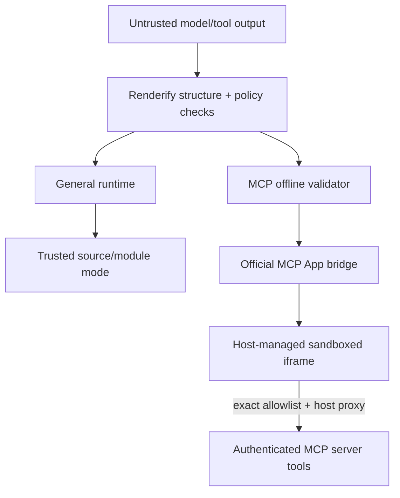

# Renderify threat model

## Scope

Renderify consumes model- or application-produced UI descriptions. A
`RuntimePlan`, its state, metadata, source, imports, and event payloads MUST be
treated as attacker-controlled unless the caller has established a stronger
trust relationship.

This document distinguishes the general Renderify runtime from the narrower
`@renderify/mcp-app` contract. The MCP package does not expose the general
runtime's trusted source path; apps that opt into source mode run source only
in a sandboxed frame nested in the view.

## Assets

| Asset | Security concern |
| --- | --- |
| Host DOM, cookies, and credentials | Script execution or sandbox escape could act as the user. |
| Data placed in plan/context/state | UI or model-context output could disclose it. |
| MCP server tools | A confused deputy could perform unauthorized side effects. |
| Network identity | Unexpected fetches could exfiltrate data or load code. |
| Module supply chain | Unpinned or unverified modules can replace executable code. |
| Availability | Large plans, repeated events, and runtime work can consume resources. |

## Trust boundaries

What this shows: direct trusted-source rendering and the offline MCP adapter
have different boundaries and MUST NOT be described as equivalent.

Trusted computing base for the MCP path: the host, browser sandbox/CSP
implementation, official MCP Apps SDK, the static shell, Renderify validators,
security checker, runtime manager, and UI renderer. A defect in those units can
invalidate the boundary.

## Attacker capabilities

The attacker may control the complete tool result plan, including text, tags,
attributes, local state, transitions, event types and payloads, and metadata.
They may send an over-limit or malformed payload, attempt active URLs or blocked
tags, request a sensitive tool, spoof a postMessage from another frame, mislead
the user, or repeat actions to consume CPU/memory.

For general trusted/relaxed runtime APIs, the attacker may also control source
and imports if the caller incorrectly treats model output as reviewed code.

## Defense layers and guarantee level

| Layer | Mechanism | Scope and strength |
| --- | --- | --- |
| IR guards | Plain-JSON shape, safe state paths, RuntimeNode traversal | Exact for the checked structure. |
| Security policy | Tags, URLs, capabilities, budgets, module policy | Exact for implemented checks; configuration can widen it. |
| Source pattern scan | Banned token/regex patterns | Best-effort only; not a JavaScript isolation boundary. |
| Declarative renderer | Tag/attribute/style/URL sanitization and delegated events | Applies to RuntimeNode rendering, not trusted Preact source output. |
| Runtime isolation profiles | Worker/iframe modes and fail-closed behavior | Depends on selected profile, browser, and host CSP. |
| MCP validator | Rejects source/modules/network/storage/timers and caps JSON size | Exact for the accepted MCP plan contract. |
| MCP shell CSP | Script hashes, no connection/worker/frame/object sources | Browser-enforced inside the resource when the host preserves it. |
| MCP source frame | Opt-in nested `@renderify/frame`, hash-pinned inline runner, view-side action allowlist | Only for apps registered with `sourceMode`; relies on the browser sandbox and on the host preserving the declared CSP. |
| Host sandbox | Unique-origin iframe and permissions policy | Host-owned; the package declares needs but cannot force host flags. |
| Official transport | Valid JSON-RPC and `event.source === window.parent` | Rejects sibling-frame messages; target origin is `*` because sandbox origins may be opaque. |
| Tool allowlist | Exact view-side name match plus host capability | Routing gate only; server authentication/authorization remains mandatory. |

## MCP App-specific rules

- Unless the app opts into source mode, the shell and `_meta.ui.csp` declare
  no external origins or browser permissions.
- A 512 KiB default limit bounds accepted plan JSON; the host still receives
  the original MCP message before view validation.
- Strict policy limits depth, node count, transitions, and actions in addition
  to the MCP-specific exclusions.
- SVG animation and timed mutation elements are rejected so browser-managed
  updates cannot change a URL attribute after validation.
- Fragment-only hrefs are element-sensitive because a `srcdoc` app inherits
  the embedding page's base URL. Navigation and resource-loading elements may
  not use those hrefs; only explicit local SVG references and functional IRIs
  are accepted.
- CSS `image-set()` and `-webkit-image-set()` are rejected in URL-bearing
  attributes and inline styles because quoted candidates can load without a
  `url()` token; CSS escapes and comments are normalized before inspection.
- URL-bearing MCP attributes cannot contain runtime templates. Rejecting them
  before execution prevents state, context, or event interpolation from
  introducing a relative or active URL after the boundary check.
- Declarative `onClick` data becomes delegated runtime events. It never becomes
  an HTML `on*` attribute or evaluated JavaScript; case-variant event attribute
  names are rejected instead of falling through to HTML serialization.
- Runtime transition dispatch uses own-property lookup, so event names such as
  `constructor` and `__proto__` cannot resolve inherited prototype members as
  action lists.
- Model-context updates contain attacker-influenced state/event data. Hosts and
  models MUST treat it as untrusted context, not instructions with authority.
- Tool arguments originate in the plan and, through bound inputs, form fields,
  and `{"$from"}` payload references, in what the user typed. Servers MUST
  validate them and require confirmation for destructive or sensitive effects.
- Forms render as inert containers whose submit is emulated, so plan content
  cannot navigate the frame or post fields to another origin. Password and
  file inputs are never read into state, payloads, or model context, which
  limits (but does not prevent) credential phishing through generated forms.
- `each` expansion is capped at 10,000 rendered nodes per render, and
  templated action paths must resolve to single safe segments before any
  state write.
- The registration helper forwards the official request context so handlers can
  inspect transport-provided authentication, cancellation, session, and request
  metadata instead of relying only on attacker-controlled tool arguments.

## MCP source mode rules

These apply only to apps registered with `sourceMode: true`
([ADR-0002](./adr/0002-sandboxed-source-frame.md)).

- Source runs only in a `sandbox="allow-scripts"` frame nested in the view,
  never in the view's window. The host bridge accepts messages only from the
  view's window and the view's bridge only from the host, so JSON-RPC posted
  from the nested frame reaches neither.
- The nested frame reaches server tools only through
  `window.renderify.action("tool:<name>", args)`, and only when `<name>` is in
  `allowedTools`. Those arguments come from model-written code: servers MUST
  validate and authorize them like any other tool input.
- The runner is inlined as a non-executing data block and allowed by its
  SHA-256 hash. The view's CSP adds that hash, `blob:`, and the declared
  module CDNs; it adds no `unsafe-eval` or script `unsafe-inline`, and frames
  and workers stay blocked.
- The declared module CDNs are an exfiltration path: code in the frame can put
  anything it was given into request URLs to them. Source payloads and tool
  results rendered in source mode MUST NOT carry secrets.
- Source payloads are limited to 256 KiB by default, and views without source
  mode reject them before anything renders.

## Sandboxed frame rules

`@renderify/frame` is the boundary for running model-written source in a
browser ([ADR-0002](./adr/0002-sandboxed-source-frame.md)).

- The iframe uses `sandbox="allow-scripts"` only. Content has an opaque origin
  and cannot read host DOM, cookies, or storage, submit forms, open popups, or
  navigate the top window.
- The `srcdoc` CSP allows scripts only from the runner origin, the configured
  module CDNs, and `blob:`, and network requests only to those CDNs. Frames,
  workers, `<base>`, and form submission are blocked.
- The runner accepts one connection, and only from `window.parent`. The host
  receives messages only on that port and validates and size-limits each one.
- Content reaches the host only through actions whose types the host
  allowlists; nothing in the host is callable from the frame.
- Synchronous loops get transpile-time time checks, and a host watchdog
  replaces the iframe when a render does not finish.
- The default runner is version-pinned and loaded with Subresource Integrity.

Frame residual risks: content can mislead users inside its rectangle; data
given to the frame can leak through module CDN request URLs; and a blocking
call that is not a loop can stall the host in browsers that run opaque-origin
frames on the embedder's thread. MCP Apps run source only when the app opts
into source mode, inside a frame nested in the view; see ADR-0002.

## Residual risks

- Declarative text and layout can still phish or mislead a user, and a
  generated form can ask for sensitive data in a plain text field.
- Repeated local transitions can grow state or consume browser resources until
  the host tears down the iframe.
- A weak or non-conforming host sandbox reduces containment; the inner CSP does
  not replace the outer iframe boundary.
- A compromised official dependency or Renderify TCB component can invalidate
  assumptions.
- The current evidence is automated testing, not a third-party security audit.
- General trusted/relaxed source modes remain trusted-code features and MUST NOT
  be inferred safe from the MCP declarative result.
- MCP source mode has been tested with the official bridge and the reference
  host's CSP, not yet on production hosts, whose CSP and frame handling may
  differ.

## Out of scope

- A malicious MCP host or server.
- Browser engine vulnerabilities that bypass CSP or iframe isolation.
- Secrets deliberately copied by the host into plan/state.
- Authorization decisions inside application-specific tools.

## Reporting

Use the private process in [`SECURITY.md`](https://github.com/webllm/renderify/blob/main/SECURITY.md). High-value reports
include a minimal plan, selected profile, host sandbox/CSP, browser version, and
demonstrated impact.
